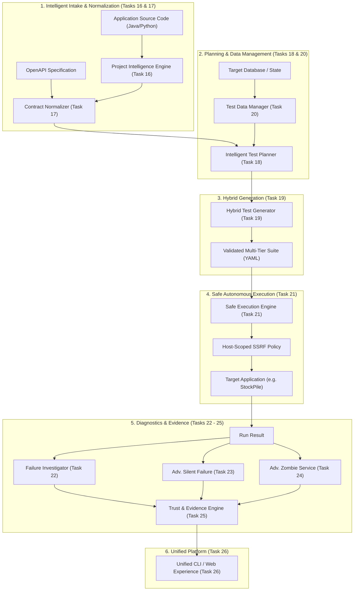
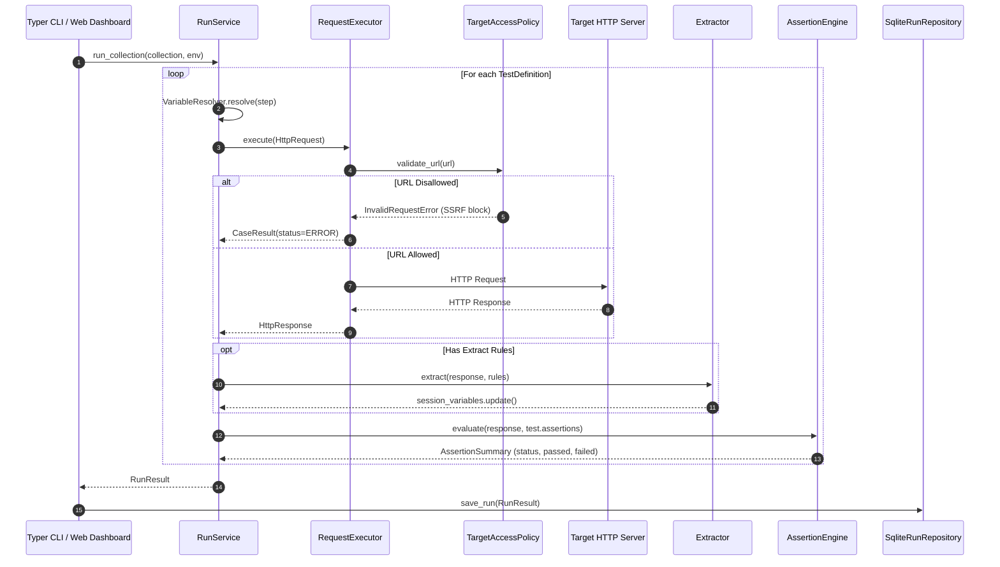
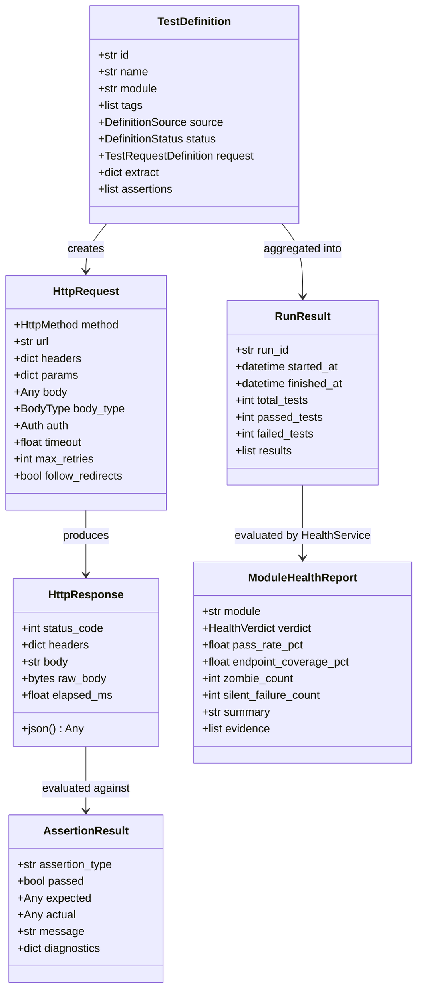

# APISCOPE EVOLUTION — ARCHITECTURE MAP & SYSTEM BLUEPRINT

**Document Version:** 1.0.0 (Evolution Baseline)  
**Target:** ApiScope Quality Engineering Platform  
**Architecture Style:** Strict Layered Architecture with Strategy & Repository Patterns  

---

## 1. System Architecture Overview

ApiScope follows a strict 3-tier layered architecture designed for deterministic execution, extensibility, and maintainability:

```
┌────────────────────────────────────────────────────────────────────────┐
│                        1. PRESENTATION LAYER                           │
│   • Typer CLI (apiscope/cli/main.py)                                   │
│   • FastAPI & Jinja2 Web Dashboard (apiscope/web/app.py)               │
└───────────────────────────────────┬────────────────────────────────────┘
                                    │
┌───────────────────────────────────▼────────────────────────────────────┐
│              2. APPLICATION SERVICES & CORE ENGINE                     │
│   • Core Execution: RequestExecutor, TargetAccessPolicy, RunService   │
│   • Declarative Evaluation: AssertionEngine, VariableResolver,         │
│     Extractor, CollectionLoader                                        │
│   • Generation Engine: OpenAPI Importer, RuleBasedGenerator,          │
│     AiGeneratorService, ProjectProfile Parser                          │
│   • Diagnostic Services: HealthService, ZombieService,                 │
│     SilentFailureService                                               │
└───────────────────────────────────┬────────────────────────────────────┘
                                    │
┌───────────────────────────────────▼────────────────────────────────────┐
│                    3. DATA & REPORTING LAYER                           │
│   • SQLite Repositories (SqliteRunRepository, CaseResultRepository)    │
│   • Multi-Format Exporters (HTML, JUnit XML, JSON Summary)             │
│   • Metric & Signal Aggregations                                       │
└────────────────────────────────────────────────────────────────────────┘
```

---

## 2. Current vs. Target Evolution Architecture

### Current State (Gate 0 Baseline)
- **Input:** Static OpenAPI YAML/JSON + manually created YAML Project Profile.
- **Generation:** Rule-based generation with placeholder values (`1`, `"test_value"`) + optional LLM prompting blind to backend code.
- **Execution:** Serial HTTP execution with all-or-nothing `--allow-local` SSRF toggle; no database fixture setup or rollback.
- **Diagnostics:** Post-hoc log file parsing (requires pre-existing `access.log` and `app.log` files on disk).

### Target State (Evolution Tasks 16–26)
- **Project Intelligence (Task 16):** Codebase scanners extract real database schemas, Spring/FastAPI routes, entities, and business validation rules directly from application source code.
- **Contract Normalization (Task 17):** Reconciles OpenAPI documentation with actual backend routes, automatically correcting generic tags (e.g. `stockpile-controller`) into distinct domain modules.
- **Intelligent Planning & TDM (Tasks 18 & 20):** Dependency-aware test ordering with isolated test data generation, database state snapshots, and automatic rollback/reset.
- **Hybrid Generation & Safety (Tasks 19 & 21):** Synthesizes deep business invariant assertions with execution safety fencing (dry-run, mutation authorization).
- **Evidence & Unified Pipeline (Tasks 22–26):** Automated root-cause classification distinguishing application bugs from test setup flaws, backed by single-command execution.



---

## 3. Component Interface Contracts & Data Flow



---

## 4. Canonical Domain Data Models



---

## 5. Architectural Boundaries for Evolution Tasks (Tasks 16–26)

| Evolution Task | Target Subsystem / Layer | New / Extended Modules | Inbound Interfaces | Outbound Interfaces |
| :--- | :--- | :--- | :--- | :--- |
| **Task 16: Project Intelligence** | Core Analysis / Extraction | `apiscope.intelligence.scanner`, `apiscope.intelligence.models` | Application source root path (Java/Python) | Discovered metadata model (`DiscoveredProjectModel`) |
| **Task 17: Contract Normalization** | Generator / Normalization | `apiscope.generators.normalizer` | Raw `OpenAPISpec` + `DiscoveredProjectModel` | Normalized `OpenAPISpec` with accurate module tags & schemas |
| **Task 18: Intelligent Test Planning** | Core Application | `apiscope.planning.planner`, `apiscope.planning.dag` | Normalized `OpenAPISpec` + dependencies | Dependency graph & ordered execution plan (`ExecutionPlan`) |
| **Task 19: Hybrid Test Generation** | Generator Engine | `apiscope.generators.hybrid_generator` | `ExecutionPlan` + LLM Provider | Multi-tier test suite with deep semantic assertions |
| **Task 20: Test Data Management** | Core Data / Fixtures | `apiscope.data.fixtures`, `apiscope.data.snapshot` | Database connection or reset HTTP webhook | Seeded test records & rollback handlers |
| **Task 21: Safe Autonomous Execution** | Core Execution | `apiscope.core.safety_fencing`, `TargetAccessPolicy` | `ExecutionPlan` + Target environment config | Non-destructive execution guarantee |
| **Task 22: Failure Investigation** | Analysis & Diagnostics | `apiscope.analysis.failure_investigator` | Failed `CaseResult` + response payloads | Root cause diagnosis (Bug vs Setup Error) |
| **Task 23: Adv. Silent Failure** | Diagnostic Engine | `apiscope.analysis.silent_failure_service` | Run results + live container log streams | Extended S1–S4 anomaly signals |
| **Task 24: Adv. Zombie Analysis** | Diagnostic Engine | `apiscope.analysis.zombie_service` | Normalized spec + access logs | Risk-ranked zombie catalog & deprecation countdown |
| **Task 25: Trust & Evidence Engine** | Reporting & Governance | `apiscope.analysis.evidence_engine` | Test results, anomaly signals, coverage | Evidence confidence score (0–100%) |
| **Task 26: Unified Workflow** | Presentation & Automation | `apiscope.cli.main`, `apiscope.workflow` | Single CLI command (`apiscope audit`) | Complete audit report, HTML dashboard, JUnit artifacts |

---

*End of Architecture Map.*
