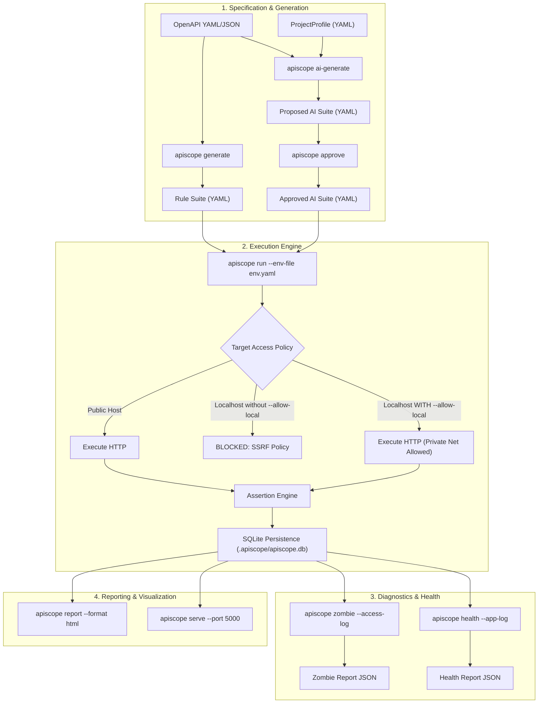

# APISCOPE EVOLUTION — GATE 0: BASELINE AUDIT & ARCHITECTURAL READINESS

**Audit Date:** 2026-11-14  
**Audit Role:** Independent Senior Software Architect, QA Specialist, Security Reviewer, and AI Systems Architect  
**Status:** Complete  
**Overall Verdict:** **READY WITH BLOCKERS** (Core test engine, coverage, and contracts are robust; critical architectural and security blockers must be resolved before Task 16 autonomous expansion)

---

## 1. Executive Summary

ApiScope is evolving from an academic automated API testing tool into an enterprise-grade, project-aware, and AI-assisted API quality assurance platform. 

This audit was conducted strictly in **read-only mode** without altering existing source code or test definitions. Its objective is to establish an empirical baseline of the existing codebase, assess the lessons learned from the real Spring Boot StockPile integration, evaluate security and governance posture, and determine architectural readiness for development Tasks 16 through 26.

### Key Audit Findings
1. **Quality Baseline:** The existing core platform is technically sound: **324 tests passing (100%)**, **89% overall test coverage**, zero Python compilation errors, and zero Ruff lint errors.
2. **StockPile Integration Reality:** When applied to a real-world enterprise target (StockPile), the automated generator produced 218 test cases, but they were predominantly generic:
   - Module tags defaulted uniformly to `stockpile-controller` due to Springdoc tag conventions.
   - Assertions were almost exclusively HTTP status-code presence checks (e.g., `equals: 200`, `equals: 204`).
   - Path parameters defaulted to arbitrary placeholder integers (`1`) or strings (`test_value`), creating tests that fail due to missing database prerequisites rather than application defects.
   - Destructive operations (`DELETE /api/expenses/1`, `POST /api/inventory/adjust`) were generated without safety fences or environment isolation.
3. **Security Blockers:**
   - **High-Severity Open Redirect SSRF:** `RequestExecutor` validates the initial URL against `TargetAccessPolicy`, but delegates redirect following to `httpx.Client(follow_redirects=True)`, allowing external servers to redirect requests to internal cloud metadata (`169.254.169.254`) or loopback services without re-validation.
   - **Over-Permissive Local Target Flag:** The CLI flag `--allow-local` sets `allow_private_networks=True`, opening access to all RFC-1918 private subnets and link-local addresses rather than scoping access specifically to an authorized host (e.g. `localhost`).
4. **AI Architecture Blockers:**
   - LLM prompt synthesis (`build_ai_generation_prompt`) only accepts the OpenAPI spec and a manually written YAML `ProjectProfile`. It has zero access to backend source code, Java controller annotations, database seed data, or business logic.
   - External OpenAPI text and user profile content are directly interpolated into LLM prompts without injection sanitization.

---

## 2. Empirical Quality Baseline (Phase 5)

Verification commands executed directly on Windows PowerShell from repository root:

### 1. Test Suite Execution (`pytest tests -q`)
```text
324 passed in 17.93s
```
- Total test items collected: **324**
- Passed: **324** (100.0%)
- Failed: **0**
- Errored: **0**
- Skipped: **0**

### 2. Code Coverage Analysis (`pytest tests --cov=apiscope --cov-report=term-missing`)
```text
TOTAL Statements: 4995 | Missed: 431 | Branches: 1788 | Partial: 290 | Coverage: 89%
```
Key Module Breakdown:
- `src/apiscope/core/executor.py`: **78%** (SSRF policy, retry, auth injection)
- `src/apiscope/core/run_service.py`: **85%** (Execution orchestration, chaining)
- `src/apiscope/core/assertions/evaluators.py`: **81%** (Status, JSONPath, JSON Schema)
- `src/apiscope/generators/rule_generator.py`: **91%** (Rule-based test synthesis)
- `src/apiscope/generators/ai_generator.py`: **88%** (AI provider, prompt construction)
- `src/apiscope/analysis/health_service.py`: **98%** (Module health verdicts)
- `src/apiscope/analysis/silent_failure_service.py`: **91%** (S1-S4 anomaly detection)
- `src/apiscope/analysis/zombie_service.py`: **90%** (Shadow & zombie endpoint detection)
- `src/apiscope/cli/main.py`: **86%** (Typer CLI commands)
- `src/apiscope/web/app.py`: **91%** (FastAPI dashboard)

### 3. Static Analysis (`ruff check .`)
```text
All checks passed! (0 errors across all files)
```

### 4. Code Formatting Verification (`ruff format --check .`)
```text
2 files would be reformatted, 99 files already formatted
- stockpile_tests/run_stockpile_extended_readonly.py (blank line spacing)
- stockpile_tests/run_stockpile_readonly_smoke.py (blank line spacing)
```
*(All 99 files under `src/` and `tests/` are 100% compliant with Ruff format guidelines).*

### 5. Bytecode Compilation (`python -m compileall src`)
```text
Listing 'src'...
Listing 'src\apiscope'...
Listing 'src\apiscope\analysis'...
Listing 'src\apiscope\cli'...
Listing 'src\apiscope\core'...
Listing 'src\apiscope\data'...
Listing 'src\apiscope\definitions'...
Listing 'src\apiscope\generators'...
Listing 'src\apiscope\reports'...
Listing 'src\apiscope\web'...
All source files compiled successfully without syntax errors.
```

---

## 3. Comprehensive Repository Inventory (Phase 1)

Detailed audit of the 17 core components in ApiScope:

### 1. `RequestExecutor`
- **Source File:** [`src/apiscope/core/executor.py`](file:///E:/3rd%20sem%20acads/SE/APIScope/src/apiscope/core/executor.py)
- **Public Interface:**
  - `class RequestExecutor(contextlib.AbstractContextManager)`
  - Methods: `__init__(config, policy, client, transport, backoff_factor, sleep_func)`, `execute(request: HttpRequest) -> HttpResponse`, `close() -> None`, `__enter__()`, `__exit__()`
- **Responsibilities:** Executes HTTP requests using `httpx`, enforces SSRF validation via `TargetAccessPolicy`, injects authentication (Bearer, Basic, API Key in header/query/cookie), manages idempotent retries with exponential backoff, sanitizes logged URLs.
- **Dependencies:** `httpx`, `apiscope.core.models`, `apiscope.core.logging_config`, `apiscope.core.exceptions`.
- **Existing Tests:** [`tests/unit/test_executor.py`](file:///E:/3rd%20sem%20acads/SE/APIScope/tests/unit/test_executor.py) (38 tests).
- **Known Limitations:** Delegates redirect handling directly to `httpx.Client(follow_redirects=True)` without re-invoking `TargetAccessPolicy.validate_url` on redirected targets (SSRF vulnerability).

### 2. `TargetAccessPolicy`
- **Source File:** [`src/apiscope/core/executor.py`](file:///E:/3rd%20sem%20acads/SE/APIScope/src/apiscope/core/executor.py)
- **Public Interface:**
  - `class TargetAccessPolicy`
  - Methods: `__init__(allow_private_networks, allowed_hosts, blocked_hosts, allowed_schemes, resolve_dns)`, `validate_url(url: str) -> None`, `is_allowed_host(host: str) -> bool`
- **Responsibilities:** Validates URLs against scheme whitelists (`http`, `https`), blocked hostnames, private IP ranges (RFC 1918, RFC 3927, loopback `127.0.0.0/8`, IPv6 `::1`), and host allowlists.
- **Dependencies:** `urllib.parse`, `ipaddress`, `socket`.
- **Existing Tests:** Covered in [`tests/unit/test_executor.py`](file:///E:/3rd%20sem%20acads/SE/APIScope/tests/unit/test_executor.py).
- **Known Limitations:** Vulnerable to DNS rebinding (TOCTOU) because pre-check DNS lookup is disconnected from `httpx` socket connection. Does not support port-level allowlisting.

### 3. `AssertionEngine`
- **Source File:** [`src/apiscope/core/assertions/engine.py`](file:///E:/3rd%20sem%20acads/SE/APIScope/src/apiscope/core/assertions/engine.py)
- **Public Interface:**
  - `class AssertionEngine(AssertionEngineProtocol)`
  - Methods: `__init__(registry)`, `register_evaluator(assertion_type, evaluator)`, `evaluate(response: HttpResponse, rules: Sequence[dict]) -> AssertionSummary`
- **Responsibilities:** Coordinates assertion evaluation using the Strategy pattern. Traps evaluator exceptions so single-assertion failures never crash test execution.
- **Dependencies:** `apiscope.core.assertions.evaluators`, `apiscope.core.assertions.models`.
- **Existing Tests:** [`tests/unit/test_assertions.py`](file:///E:/3rd%20sem%20acads/SE/APIScope/tests/unit/test_assertions.py) (53 tests).
- **Known Limitations:** Built-in strategies are limited to `status`, `max_time_ms`, `header`, `jsonpath`, and `json_schema`. Lacks cross-field relational comparisons, statistical aggregations, and business invariant math engines.

### 4. `VariableResolver`
- **Source File:** [`src/apiscope/core/variables.py`](file:///E:/3rd%20sem%20acads/SE/APIScope/src/apiscope/core/variables.py)
- **Public Interface:**
  - `class VariableResolver`
  - Methods: `resolve_string(template: str, variables: Mapping[str, Any]) -> str`, `resolve_data(data: Any, variables: Mapping[str, Any]) -> Any`
- **Responsibilities:** Interpolates `{{variable_name}}` placeholders across URLs, headers, query parameters, and request bodies.
- **Dependencies:** Standard library `re`.
- **Existing Tests:** Covered in [`tests/unit/test_core.py`](file:///E:/3rd%20sem%20acads/SE/APIScope/tests/unit/test_core.py).
- **Known Limitations:** Supports simple string replacement only. Does not support inline transformations (e.g. `{{timestamp | format}}`), hashing, default fallbacks, or mathematical expressions.

### 5. `Extractor`
- **Source File:** [`src/apiscope/core/extractor.py`](file:///E:/3rd%20sem%20acads/SE/APIScope/src/apiscope/core/extractor.py)
- **Public Interface:**
  - `class Extractor`
  - Methods: `extract(response: HttpResponse, extract_rules: Mapping[str, str]) -> dict[str, Any]`
- **Responsibilities:** Extracts values from HTTP response headers and JSON bodies using JSONPath expressions (`$.field`, `$.items[0].id`) for runtime variable chaining.
- **Dependencies:** `jsonpath-ng`, `apiscope.core.models`.
- **Existing Tests:** [`tests/unit/test_extractor.py`](file:///E:/3rd%20sem%20acads/SE/APIScope/tests/unit/test_extractor.py) (8 tests).
- **Known Limitations:** Fails if the producer response does not match the exact JSONPath expression; has no regex-based extraction for plain-text bodies or HTML.

### 6. `RunService`
- **Source File:** [`src/apiscope/core/run_service.py`](file:///E:/3rd%20sem%20acads/SE/APIScope/src/apiscope/core/run_service.py)
- **Public Interface:**
  - `class RunService`
  - Methods: `run_collection(collection: TestCollection, environment: Environment, ...) -> RunResult`, `run_test(test: TestDefinition, ...) -> CaseResult`
- **Responsibilities:** Orchestrates test suite execution: resolves variables per step, executes HTTP requests, extracts response values into session state for consumer steps, evaluates assertions, calculates elapsed times, enforces suite timeouts.
- **Dependencies:** `RequestExecutor`, `AssertionEngine`, `VariableResolver`, `Extractor`, `RunResult`.
- **Existing Tests:** [`tests/integration/test_run_service.py`](file:///E:/3rd%20sem%20acads/SE/APIScope/tests/integration/test_run_service.py) (12 tests).
- **Known Limitations:** Execution is strictly serial. Lacks concurrency, dependency graph DAG scheduling, data setup/teardown transaction brackets, or conditional branching based on step outcomes.

### 7. `OpenAPI Importer`
- **Source File:** [`src/apiscope/generators/openapi_importer.py`](file:///E:/3rd%20sem%20acads/SE/APIScope/src/apiscope/generators/openapi_importer.py)
- **Public Interface:**
  - `load_openapi_spec(spec_path: str | Path, base_dir: Path | None) -> OpenAPISpec`
  - Classes: `OpenAPISpec`, `EndpointDefinition`, `ParameterDefinition`, `RequestBodyDefinition`
- **Responsibilities:** Parses OpenAPI 3.0.x and 3.1.x specifications from YAML/JSON files, resolves internal `$ref` schemas, extracts security requirements, normalizes paths.
- **Dependencies:** `pyyaml`, `pathlib`.
- **Existing Tests:** [`tests/unit/test_openapi_importer.py`](file:///E:/3rd%20sem%20acads/SE/APIScope/tests/unit/test_openapi_importer.py) (6 tests).
- **Known Limitations:**
  - Module classification blindly takes `tags[0]`. When Springdoc tags all endpoints as `stockpile-controller`, the spec importer fails to infer meaningful domain modules from path prefixes (e.g. `/api/products` vs `/api/sales`).
  - Circular schema references can cause recursion depth limits.

### 8. `RuleBasedGenerator`
- **Source File:** [`src/apiscope/generators/rule_generator.py`](file:///E:/3rd%20sem%20acads/SE/APIScope/src/apiscope/generators/rule_generator.py)
- **Public Interface:**
  - `class RuleBasedGenerator`
  - Methods: `generate_tests(spec: OpenAPISpec, ...) -> list[TestDefinition]`, `generate_crud_chains(...) -> list[TestDefinition]`
  - Helper: `synthesize_valid_value(schema: dict, field_name: str) -> Any`
- **Responsibilities:** Generates positive happy-path tests, negative unsupported-method tests (DELETE returning 405), invalid path parameter tests (returning 404), boundary parameter tests, and 2-step CRUD chaining.
- **Dependencies:** `OpenAPISpec`, `TestDefinition`, `TestRequestDefinition`.
- **Existing Tests:** [`tests/unit/test_rule_generator.py`](file:///E:/3rd%20sem%20acads/SE/APIScope/tests/unit/test_rule_generator.py) (8 tests).
- **Known Limitations:**
  - Relies on dummy default values (`1` for integers, `test_<field>` for strings).
  - Assumes DELETE is unsupported for all endpoints not defining DELETE, which generates unrealistic 405 probes.
  - CRUD chain generator falls back to `$.id` if the schema uses polymorphic `allOf`, causing chaining to fail on targets using domain IDs like `$.asset_id` or `$.saleId`.

### 9. `AiGeneratorService`
- **Source File:** [`src/apiscope/generators/ai_generator.py`](file:///E:/3rd%20sem%20acads/SE/APIScope/src/apiscope/generators/ai_generator.py)
- **Public Interface:**
  - `class AiGeneratorService`
  - Methods: `generate_ai_suite(spec_path, profile_path, output_path, ...) -> TestCollection`, `approve_suite(suite_path, ...) -> TestCollection`
  - Protocols & Adapters: `LLMProviderProtocol`, `LiveHttpLLMProvider`, `ProfileDrivenSynthesisProvider`
- **Responsibilities:** Prompts external LLMs (Gemini/OpenAI) or uses offline deterministic synthesis to produce business-logic, state-machine, and IDOR test suites. Forces governance tags (`source: ai-generated`, `status: proposed`) and validates that no test is generated with 0 assertions.
- **Dependencies:** `httpx`, `pyyaml`, `OpenAPISpec`, `ProjectProfile`.
- **Existing Tests:** [`tests/unit/test_ai_generator.py`](file:///E:/3rd%20sem%20acads/SE/APIScope/tests/unit/test_ai_generator.py) (13 tests).
- **Known Limitations:**
  - Only passes OpenAPI spec and manual YAML project profile to the LLM. It has no mechanism to read backend code or database schemas.
  - Vulnerable to prompt injection if untrusted OpenAPI documentation contains adversarial prompt text.

### 10. Existing `ProjectProfile` Models
- **Source File:** [`src/apiscope/generators/project_profile.py`](file:///E:/3rd%20sem%20acads/SE/APIScope/src/apiscope/generators/project_profile.py)
- **Public Interface:**
  - `load_project_profile(path: str | Path, base_dir: Path | None) -> ProjectProfile`
  - Dataclasses: `ProjectProfile`, `RoleRule`, `StateTransitionRule`, `BusinessInvariantRule`
- **Responsibilities:** Loads declarative project metadata: user roles and allowed/forbidden endpoints, state machine transitions, single-use business invariants, and sensitive field denylists.
- **Dependencies:** `pyyaml`, `pathlib`.
- **Existing Tests:** [`tests/unit/test_project_profile_and_polymorphic.py`](file:///E:/3rd%20sem%20acads/SE/APIScope/tests/unit/test_project_profile_and_polymorphic.py) (4 tests).
- **Known Limitations:** Static YAML format requires manual human authoring. Lacks automated discovery from backend frameworks or codebase code analysis.

### 11. Human Approval Workflow
- **Source File:** [`src/apiscope/generators/ai_generator.py`](file:///E:/3rd%20sem%20acads/SE/APIScope/src/apiscope/generators/ai_generator.py) (`approve_suite`) & [`src/apiscope/cli/main.py`](file:///E:/3rd%20sem%20acads/SE/APIScope/src/apiscope/cli/main.py) (`apiscope approve`)
- **Public Interface:** `approve_suite(suite_path, output_path, test_names, base_dir)`
- **Responsibilities:** Enforces safety gating: reads proposed test suites (`status: proposed`), verifies non-empty assertions, updates status to `approved`, and writes approved suite to disk.
- **Dependencies:** `TestCollection`, `yaml_loader`.
- **Existing Tests:** [`tests/integration/test_ai_workflow_and_governance.py`](file:///E:/3rd%20sem%20acads/SE/APIScope/tests/integration/test_ai_workflow_and_governance.py) (3 tests).
- **Known Limitations:** Binary approve/reject mechanism. Does not support inline test editing, parameter patching, or assertion refinement during review.

### 12. `HealthService`
- **Source File:** [`src/apiscope/analysis/health_service.py`](file:///E:/3rd%20sem%20acads/SE/APIScope/src/apiscope/analysis/health_service.py)
- **Public Interface:**
  - `class HealthService`
  - Methods: `evaluate_module(...) -> ModuleHealthReport`, `evaluate_all_modules(...) -> list[ModuleHealthReport]`
- **Responsibilities:** Computes functional pass rate, endpoint coverage against OpenAPI, contract conformance, negative/boundary stats, authentication check stats, p95 latency drift, and assigns a 4-state verdict (`HEALTHY`, `HEALTHY_WITH_WARNINGS`, `UNHEALTHY`, `INCOMPLETE`).
- **Dependencies:** `apiscope.analysis.health_models`, `apiscope.core.results`.
- **Existing Tests:** [`tests/unit/test_health_service.py`](file:///E:/3rd%20sem%20acads/SE/APIScope/tests/unit/test_health_service.py) (8 tests).
- **Known Limitations:** If log entries are omitted, assigns `HEALTHY` based purely on passing HTTP requests, giving a false sense of security when silent failures or zombie endpoints were simply not evaluated.

### 13. `ZombieService`
- **Source File:** [`src/apiscope/analysis/zombie_service.py`](file:///E:/3rd%20sem%20acads/SE/APIScope/src/apiscope/analysis/zombie_service.py)
- **Public Interface:**
  - `class ZombieService`
  - Methods: `detect_zombies(openapi_spec, access_log_entries, ...) -> list[ZombieFinding]`, `ingest_access_log_file(file_path) -> list[AccessLogEntry]`
- **Responsibilities:** Parses standard Common/Combined web server access logs, correlates active HTTP traffic against OpenAPI endpoints, detects uninvoked documented endpoints, undocumented zombie endpoints, and shadow methods.
- **Dependencies:** `apiscope.analysis.path_normalizer`, `re`.
- **Existing Tests:** [`tests/unit/test_zombie_service.py`](file:///E:/3rd%20sem%20acads/SE/APIScope/tests/unit/test_zombie_service.py) (4 tests).
- **Known Limitations:** Requires pre-existing, formatted `access.log` on disk. Cannot attach to live container streams or application middleware dynamically.

### 14. `SilentFailureService`
- **Source File:** [`src/apiscope/analysis/silent_failure_service.py`](file:///E:/3rd%20sem%20acads/SE/APIScope/src/apiscope/analysis/silent_failure_service.py)
- **Public Interface:**
  - `class SilentFailureService`
  - Methods: `detect_silent_failures(run_result, app_log_entries, probe_results, ...) -> list[SilentFailureSignal]`, `ingest_app_log_file(file_path) -> list[AppLogEntry]`
- **Responsibilities:** Correlates 200 OK responses with error keywords in JSON payloads (S1), swallowed backend exceptions in application logs (S2), degraded health probes (S3), and unexpectedly empty payloads (S4).
- **Dependencies:** `apiscope.core.results`, `re`.
- **Existing Tests:** [`tests/unit/test_silent_failure_service.py`](file:///E:/3rd%20sem%20acads/SE/APIScope/tests/unit/test_silent_failure_service.py) (6 tests).
- **Known Limitations:** Relies on timestamp proximity heuristic (±5 seconds) to correlate HTTP requests with log lines when correlation IDs (`X-Correlation-ID`) are absent.

### 15. SQLite Persistence Repositories
- **Source Files:** [`src/apiscope/data/connection.py`](file:///E:/3rd%20sem%20acads/SE/APIScope/src/apiscope/data/connection.py), [`src/apiscope/data/repositories.py`](file:///E:/3rd%20sem%20acads/SE/APIScope/src/apiscope/data/repositories.py)
- **Public Interface:**
  - `get_db_connection(db_path)`
  - Classes: `SqliteRunRepository`, `SqliteCaseResultRepository`
  - Methods: `save_run(run_result)`, `get_run(run_id)`, `list_runs()`, `save_case_result(case_result)`
- **Responsibilities:** Persists test execution run metadata, individual test case outcomes, execution latencies, and detailed assertion results in SQLite database.
- **Dependencies:** `sqlite3`, `apiscope.core.results`.
- **Existing Tests:** [`tests/unit/test_repositories.py`](file:///E:/3rd%20sem%20acads/SE/APIScope/tests/unit/test_repositories.py) (7 tests).
- **Known Limitations:** Stores unencrypted response payloads and raw assertion diagnostics. Lacks database migration versioning (`alembic` or version PRAGMAs).

### 16. Typer CLI
- **Source File:** [`src/apiscope/cli/main.py`](file:///E:/3rd%20sem%20acads/SE/APIScope/src/apiscope/cli/main.py)
- **Public Interface:** Typer application `app` with commands: `run`, `generate`, `ai-generate`, `approve`, `health`, `zombie`, `report`, `serve`.
- **Responsibilities:** CLI presentation layer: parses options, enforces safe file paths, formats console tables using `rich`, handles exit codes.
- **Dependencies:** `typer`, `rich`, all core and analysis services.
- **Existing Tests:** [`tests/integration/test_cli_run_and_report.py`](file:///E:/3rd%20sem%20acads/SE/APIScope/tests/integration/test_cli_run_and_report.py) (11 tests), [`tests/integration/test_cli_health.py`](file:///E:/3rd%20sem%20acads/SE/APIScope/tests/integration/test_cli_health.py) (4 tests).
- **Known Limitations:** Only provides `--allow-local` (broad private network access); lacks granular host targeting (`--allowed-host`).

### 17. FastAPI Dashboard
- **Source File:** [`src/apiscope/web/app.py`](file:///E:/3rd%20sem%20acads/SE/APIScope/src/apiscope/web/app.py)
- **Public Interface:** `create_app(db_path, spec_path, access_log, app_log, health_file) -> FastAPI`
- **Responsibilities:** Web presentation layer: renders Jinja2 HTML dashboard templates with embedded Chart.js visualizations, displays run history, provides interactive drill-downs for case results and diagnostic anomalies, exposes `/api/trigger-run`.
- **Dependencies:** `fastapi`, `jinja2`, `uvicorn`, `apiscope.data.repositories`.
- **Existing Tests:** [`tests/unit/test_web_dashboard.py`](file:///E:/3rd%20sem%20acads/SE/APIScope/tests/unit/test_web_dashboard.py) (9 tests).
- **Known Limitations:** Single-user local dashboard; no authentication or session authorization; in-memory background task execution for `/api/trigger-run`.

---

## 4. Current User Workflow Trace & CLI Integration Analysis (Phase 2)



### Disconnects in Standard CLI Workflow
1. **Manual Glue Required for Local Applications:**
   When testing local applications like StockPile (`http://localhost:8080`), running `apiscope run` by default aborts with an SSRF error. Users must remember to supply `--allow-local` or export `APISCOPE_ALLOW_LOCAL=1`.
2. **Lack of Automated Multi-Step Pipeline:**
   The CLI requires 7 distinct manual invocations (`generate` → `ai-generate` → `approve` → `run` → `zombie` → `health` → `report`). In PowerShell, teams had to write wrapper scripts ([`run_offline_demo.ps1`](file:///E:/3rd%20sem%20acads/SE/APIScope/run_offline_demo.ps1) and [`run_live_ai_demo.ps1`](file:///E:/3rd%20sem%20acads/SE/APIScope/run_live_ai_demo.ps1)) to orchestrate them sequentially.
3. **Database State Reset Disconnect:**
   Neither `apiscope run` nor `RunService` has any concept of pre-test fixtures or database state resets. For `sample_app`, the demo scripts had to manually execute `Invoke-RestMethod -Method Post -Uri "http://127.0.0.1:8000/_test/reset"` between runs to avoid cascading `404` errors caused by earlier `DELETE` tests.

---

## 5. StockPile Integration Gap Analysis (Phase 3)

Review of local StockPile artifacts:
- [`stockpile_tests/stockpile_openapi.yaml`](file:///E:/3rd%20sem%20acads/SE/APIScope/stockpile_tests/stockpile_openapi.yaml) (73 KB Spring Boot OpenAPI spec, 44 paths, 60 operations)
- [`stockpile_tests/generated_suite.yaml`](file:///E:/3rd%20sem%20acads/SE/APIScope/stockpile_tests/generated_suite.yaml) (218 auto-generated tests)
- [`stockpile_tests/stockpile_extended_readonly.yaml`](file:///E:/3rd%20sem%20acads/SE/APIScope/stockpile_tests/stockpile_extended_readonly.yaml) (30 curated read-only tests)
- [`stockpile_tests/stockpile_extended_results.json`](file:///E:/3rd%20sem%20acads/SE/APIScope/stockpile_tests/stockpile_extended_results.json) (120 passed assertions)

### 8 Concrete Gaps Identified

| # | Gap Area | Confirmed Root Cause in Codebase | Concrete Impact on StockPile Testing |
| :- | :--- | :--- | :--- |
| **1** | **Placeholder Resource IDs** | `synthesize_valid_value` in `rule_generator.py:107-140` synthesizes integers as `1` and strings as `"test_value"` when no OpenAPI examples exist. | Generated tests request `/api/expenses/1`, `/api/products/1`, `/api/suppliers/1`. If record `1` does not exist in SQLite, the test fails with `404` despite no software bug existing. |
| **2** | **Superficial Status-Code Assertions** | `RuleBasedGenerator._generate_positive_test` only creates `status == 200` and top-level schema check. | Tests verify that the HTTP server responds, but cannot detect incorrect calculations, data corruption, or empty collections. |
| **3** | **Generic Module Classification** | `_extract_module` in `openapi_importer.py:46` takes `tags[0]`. Spring Boot's Springdoc assigned `["stockpile-controller"]` to all 60 endpoints. | All 60 operations collapsed into a single `stockpile-controller` module, destroying module-level granularity in the health report. |
| **4** | **Unsatisfied Prerequisites in Positive Tests** | No dependency graph or topological sorting. `DELETE /api/expenses/1` and `PUT /api/expenses/1` run before any expense is created. | Tests fail due to missing seed data rather than application defects. |
| **5** | **Unsupported Behavior Assumed in Negative Tests** | `_generate_unsupported_method_tests` sends `DELETE` to all endpoints not declaring DELETE, asserting `status == 405`. | Spring Boot applications often return `404` or `400` instead of `405` depending on URL pattern matching, generating false alarms. |
| **6** | **LLM Generation Blind to Backend Implementation** | `build_ai_generation_prompt` only passes OpenAPI endpoints and YAML profile metadata. It cannot read Java controllers or Spring `@Service` code. | LLM hallucinates non-existent endpoints or fails to test actual business logic implemented in `StockpileService.java`. |
| **7** | **Absence of Test Data Management (TDM)** | ApiScope has no fixture lifecycle, database snapshot mechanism, or teardown hooks. | Destructive tests (`DELETE /api/products/1`) permanently alter target application state, contaminating subsequent test runs. |
| **8** | **Indistinguishable Failure Diagnostics** | `CaseResult` only records `status: FAILED` and the assertion failure message. | Engineers cannot tell whether a `404` was caused by a routing bug or because the test requested a hardcoded ID `999` that was never created. |

---

## 6. Security & AI Governance Assessment (Phase 4)

| Risk Finding | Severity | CWE / Category | Evidence in Codebase | Recommended Architectural Mitigation |
| :--- | :---: | :--- | :--- | :--- |
| **Open Redirect SSRF Bypass** | **HIGH** | CWE-918 / CWE-601 | `src/apiscope/core/executor.py:370` uses `self._client.request(..., follow_redirects=request.follow_redirects)`. Initial URL is checked against `TargetAccessPolicy`, but redirect locations are never validated. | Implement custom `httpx.HTTPTransport` or event hook that intercepts 3xx redirects and calls `self.policy.validate_url(redirect_url)` before following. |
| **Over-Permissive `--allow-local` Flag** | **MEDIUM** | CWE-272 | `src/apiscope/cli/main.py:314` sets `allow_private_networks=True` on `--allow-local`, opening up AWS metadata (`169.254.169.254`) and all private subnets. | Introduce host-scoped authorization: `--allowed-host localhost` or `--allow-target <url>`. |
| **Destructive Mutation Execution** | **HIGH** | Safety / Data Loss | `RuleBasedGenerator` outputs `DELETE` and mutating `POST` requests without environment safety gating. | Add execution safety mode: `--safe-mode` / `--dry-run` rejecting non-idempotent or destructive methods on unconfirmed targets. |
| **Prompt Injection in LLM Pipeline** | **HIGH** | AI Security (OWASP LLM01) | `build_ai_generation_prompt` concatenates untrusted OpenAPI schema text and user profile notes directly into prompt text. | Sanitize input fields, delimit untrusted data with structured XML tags, and validate LLM output against strict JSON schema. |
| **Unencrypted Sensitive Data in Run Database** | **LOW** | CWE-312 | `SqliteCaseResultRepository` saves raw response bodies and assertion diagnostics in plain SQLite text. | Apply sensitive field redaction (`redact_sensitive_text`) prior to database insertion. |

---

## 7. Overall Readiness Decision & Conclusion

### Verdict: **READY WITH BLOCKERS**

### Decision Rationale
1. **Strengths (Why it is Ready):**
   - Core HTTP execution, variable interpolation, response extraction, and deterministic assertion engines have 100% pass rates and 89% coverage across 324 tests.
   - The modular layered architecture (`core`, `definitions`, `generators`, `analysis`, `data`, `reports`, `cli`, `web`) is clean, decoupled, and highly extensible.
   - The diagnostic engines (Zombie and Silent Failure services) provide foundational anomaly detection.
2. **Blockers That Must Be Resolved Before Task 16 (Why it has Blockers):**
   - **BLOCKER-01 (Security):** Fix SSRF open redirect vulnerability in `RequestExecutor`.
   - **BLOCKER-02 (Security/CLI):** Implement granular host-scoped target authorization (`--allowed-host`) so developers can test local targets without disabling global private network protections.
   - **BLOCKER-03 (Data Safety):** Introduce read-only / mutation safety flags in `RuleBasedGenerator` and `RunService` to prevent automated suites from inadvertently deleting live target data.
   - **BLOCKER-04 (Architecture):** Expand OpenAPI module extraction so endpoints are intelligently grouped by path prefix when OpenAPI tags are monolithic or generic.

---

*Baseline Audit complete. Proceed to `docs/EVOLUTION_ARCHITECTURE_MAP.md` and `docs/EVOLUTION_BACKLOG.md`.*
